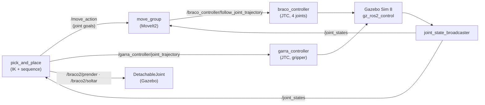

# 4-DOF Robot Arm with MoveIt2

> A 4-DOF serial robot arm with a rack-and-pinion parallel gripper, designed for 3D printing in PLA around DYNAMIXEL servos, and simulated end to end in ROS 2: CAD → URDF → Gazebo + ros2_control → MoveIt2 → pick and place.

[](https://docs.ros.org/en/jazzy/)
[](https://www.python.org/)
[-E95420?logo=ubuntu&logoColor=white)](https://ubuntu.com/)
[](https://github.com/Danion1/robot-arm-moveit2/actions/workflows/ci.yml)
[](LICENSE)

🇧🇷 [Versão em português](README.pt-BR.md)

---

## Demo


Full video (34 s):

https://github.com/user-attachments/assets/49e8848e-3dfa-48d0-ab95-0e6c0371d6d8

It was rendered by a simulated camera in lockstep with the physics, so it plays smoothly even though the simulation ran on a CPU-only WSL2 machine (1029 frames, 0 dropped).

**Status:** Simulated only. CAD designed for fabrication, not printed yet. Kinematics, URDF, Gazebo torques, MoveIt2 collision checking and the pick and place are validated against the CAD (numbers below).

*Developed in a private workspace (Oct 10–14, 2026); this repository is the cleaned public release. CI builds the ROS 2 packages and runs their tests on every push.*

---

## Overview

The goal was a single model that serves both simulation and fabrication. The arm is designed parametrically in Python (CadQuery): screws follow ISO tables, servo mounting holes come from the ROBOTIS drawings, and plate thickness comes from a stress calculation at servo stall torque. The same script produces the meshes, masses and inertias for the URDF. Every stage has an automatic check against an independent reference before anything is exported.

Key points:
- **Parametric CAD in CadQuery**: one model gives printable STEP/STL parts and the simulation meshes.
- **Analytic inverse kinematics** (planar arm + base yaw, law of cosines), validated against the CAD solids and in Gazebo.
- **Gazebo + ros2_control** with position command (the real servos' default mode); simulated gravity torques match the hand calculation from the CAD masses within 0.15 %.
- **MoveIt2** collision checking cross-checked against the CAD solids: no pose that MoveIt2 marks free collides in the CAD (600 random poses).
- **Pick and place** with a verified grasp: the gripper must stop on the object before its target, or the node aborts without grasping.

---

## Architecture



| Component | Role | Written by me / configured |
|---|---|---|
| `cad/*.py` (CadQuery) | parts, assembly, mass/inertia, meshes, URDF and MoveIt2 config generators, all with checks | written (with AI assistance) |
| `braco2_description` | URDF, meshes, Gazebo worlds, launch files | URDF generated; `controladores.yaml` and `gazebo.launch.py` written by hand |
| `braco2_nos/cinematica.py` | forward and inverse kinematics, 15 unit tests | written |
| `braco2_nos/mover_para_ponto.py` | node: Cartesian target → IK → joint trajectory | written by hand |
| `braco2_nos/pick_and_place.py` | node: full pick and place through MoveIt2 with grasp check | written (with AI assistance) |
| `braco2_moveit_config` | SRDF, collision matrix, limits, controllers | generated by script, then validated |
| MoveIt2, ros2_control, Gazebo | planning, control, physics | configured |

---

## Engineering decisions

Full list with alternatives: [docs/decisions.md](docs/decisions.md).

| Decision | Alternative considered | Why |
|---|---|---|
| Serial arm | Parallelogram | The closed loop is poorly described in URDF and complicates MoveIt2; accepted more shoulder torque for simpler software |
| XM430-W350 (base, shoulder, elbow), XC430-W240 (wrist, gripper) | XM540 (heavier), XW430 (contradictory datasheet) | Chosen by torque calculation from the CAD masses |
| Position command interface | Effort command | It is the real servos' default mode, and the XC430 has no torque mode: simulating something the hardware cannot do would not transfer |
| Analytic IK, MoveIt2 driven with joint goals | MoveIt2's KDL solver | With 4 joints KDL only solves position (orientation ends up arbitrary) |
| Collision = one box per part, 1 mm margin | Detailed mesh / convex hull | Mesh is slow; a convex hull closes the gripper and fork openings |
| Hybrid grasp: physics closes, grasp is checked, then a fixed joint holds | Pure friction / always attach / teleport | Pure friction grasps are unstable in Gazebo; always attaching would hide a bad grasp |
| Bullet-Featherstone physics for the pick and place world | DART (Gazebo default) | DART does not support the gripper's mimic joint, so only one finger moved |

---

## Validation

All results come from scripts that run without a GUI, in a temporary workspace and an isolated ROS domain.

| What | Method | Result |
|---|---|---|
| Forward kinematics | Hand formula vs. CAD solid chain (30 poses) and vs. URDF chain | max error 1.1e-13 mm |
| Inverse kinematics | 15 unit tests + IK of poses taken from the CAD solids (30 poses) | tests pass; max error 4.4e-13° |
| URDF | Generator checks: masses = CAD, total 740 g, limits, `check_urdf`, collision boxes = CAD boxes | 7 checks pass |
| Gazebo + ros2_control | 5 Cartesian targets through `mover_para_ponto` | TF error 0.000 mm; joint torques vs. CAD gravity < 0.15 %; unreachable target refused |
| MoveIt2 collision | 600 random poses (with and without table), MoveIt2 vs. CAD solid intersection | agree on 565; 0 dangerous (MoveIt2 says free, CAD collides); 35 conservative |
| MoveIt2 trajectories | 10 planned and executed moves, interpolated in 1° steps against the CAD | all collision-free, within limits and velocity, end on target; detour found where the straight joint path would hit the table |
| Grasp physics | Gazebo: mimic, empty grasp, approach, closing, lift, place | gripper stops at 10.7-11.0 mm per finger on a 20 mm cube (contact expected at 11.0); lifted 40 mm with the hand |
| Pick and place node | Round trip (2 grasps) + grasp on an empty spot | object back within 5 mm; empty grasp rejected without attaching |

Reproduce (from `ros2/`):
```bash
bash conferir_mover.sh              # Gazebo + mover_para_ponto (~2 min)
CADQUERY_PYTHON=/path/to/venv/bin/python bash conferir_moveit.sh   # MoveIt2 vs. CAD (~10 min)
bash conferir_pega.sh               # grasp physics (~3 min)
bash conferir_pick_and_place.sh     # pick_and_place node (~5 min)
bash gravar_demo.sh                 # records midia/pick_and_place.mp4 (~4 min)
```

---

## Designed for fabrication

<p align="center">
  
  
</p>

| Part | Qty | Source |
|---|---|---|
| DYNAMIXEL XM430-W350-T | 3 | [ROBOTIS e-Manual](https://emanual.robotis.com/docs/en/dxl/x/xm430-w350/) |
| DYNAMIXEL XC430-W240-T | 2 | [ROBOTIS e-Manual](https://emanual.robotis.com/docs/en/dxl/x/xc430-w240/) |
| Socket head screws ISO 4762 + hex nuts ISO 4032 (embedded in the plastic) | per assembly | ISO tables in `cad/lib/parafusos_iso.py` |
| Printed parts (base tripod, tower, link plates, gripper with m2 z18 pinion and racks) | 19 | [Print and assemble](#print-and-assemble) |

Printable parts: STL and STEP for every part are in `cad_export/`, generated by the `cad/` scripts; PLA (density and strength from the SD3D PLA datasheet). Every datasheet and standard used is linked in [docs/sources.md](docs/sources.md). Clearances that depend on the printer are marked ASSUMED in a single parameter, to be replaced after a test print. **Not built yet.**

Key numbers: links 105 / 90 / 83.5 mm; reach 278.5 mm; total mass 740 g; payload 56 g with the arm fully extended (shoulder-limited); the base must be clamped to the table (free, the arm tips over).

### Print and assemble

There is no single-piece print: every part below is printed on its own, and the parts bolt together around the servos. Click an STL to see it in 3D on GitHub (the download button is on that page), or get everything at once with **Code → Download ZIP**. Quantities come from the bill of materials printed by the CAD scripts.

| Printed part | Qty | File | Goes on |
|---|---|---|---|
| Base (tripod plate + servo cradle) | 1 | [base.stl](cad_export/base/base.stl) | table, holds the base servo |
| Tower (print it on its side) | 1 | [torre.stl](cad_export/base/torre.stl) | base servo horn → shoulder servo |
| Upper arm plate | 2 | [braco/chapa.stl](cad_export/braco/chapa.stl) | shoulder → elbow (one on the horn side, one on the idler side) |
| Upper arm flange | 1 | [braco/flange.stl](cad_export/braco/flange.stl) | spacer at the elbow servo |
| Forearm plate | 2 | [antebraco/chapa.stl](cad_export/antebraco/chapa.stl) | elbow → wrist |
| Forearm flange | 1 | [antebraco/flange.stl](cad_export/antebraco/flange.stl) | spacer at the wrist servo |
| Bridge | 2 | [junta/ponte.stl](cad_export/junta/ponte.stl) | spacer between the two plates of each link (one per link) |
| Hand plate | 2 | [chapa_mao.stl](cad_export/garra/chapa_mao.stl) | wrist → gripper servo |
| Pinion (m2, z18) | 1 | [pinhao.stl](cad_export/garra/pinhao.stl) | gripper servo horn |
| Rack | 2 | [cremalheira.stl](cad_export/garra/cremalheira.stl) | driven by the pinion, one per finger |
| Jaw | 2 | [mordente.stl](cad_export/garra/mordente.stl) | bolted to each rack |
| Upper / lower guide | 1 + 1 | [guia_cima.stl](cad_export/garra/guia_cima.stl), [guia_baixo.stl](cad_export/garra/guia_baixo.stl) | rails for the racks, on the gripper servo |

19 printed parts in PLA. (`cad_export/junta/chapa.stl` is the stand-alone joint fork used to validate the plate design; the arm does not use it.)

Hardware to buy, besides the 5 servos: ISO 4762 socket head screws M2×5 (48), M2×6 (8), M2×8 (28), M2×10 (8), M2.5×6 (14), M2.5×8 (8), M2.5×12 (8), M2.5×16 (4); ISO 4032 M2 hex nuts (28, embedded in the plastic); 3 M3 screws or clamps to fix the base to the table. Controller, power supply and cabling are not designed yet.

Not printed yet: print orientation (except the tower), supports and infill are untested, and printer-dependent clearances are a single ASSUMED parameter to be tuned after a test print.

---

## Tech stack

- **Robotics:** ROS 2 Jazzy, ros2_control, Gazebo Sim 8 (gz_ros2_control), MoveIt2, RViz2
- **CAD:** CadQuery (Python, OpenCASCADE)
- **Languages:** Python 3.12, URDF/Xacro, SRDF, SDF, YAML
- **Environment:** Ubuntu 24.04 on WSL2 (WSLg for GUIs)

---

## Getting started

### Prerequisites
- ROS 2 Jazzy (`source /opt/ros/jazzy/setup.bash`)
- `sudo apt install ros-jazzy-moveit ros-jazzy-ros-gz ros-jazzy-gz-ros2-control ros-jazzy-ros2-controllers`
- To regenerate the CAD: a Python venv with CadQuery (`pip install cadquery`)

### Build
```bash
git clone https://github.com/Danion1/robot-arm-moveit2.git
mkdir -p ~/ros2_ws/src
ln -s "$PWD"/robot-arm-moveit2/ros2/braco2_* ~/ros2_ws/src/
cd ~/ros2_ws
colcon build --symlink-install
source install/setup.bash
colcon test --packages-select braco2_nos && colcon test-result --verbose   # kinematics unit tests
```

### Run
```bash
# Terminal 1: Gazebo + MoveIt2 + RViz2 with the cube on the table
ros2 launch braco2_moveit_config pick_and_place.launch.py

# Terminal 2: pick the cube and place it on the other side (ciclos:=2 brings it back)
ros2 run braco2_nos pick_and_place --ros-args -p ciclos:=2
```

### Regenerate the CAD (optional)
The meshes, URDF and MoveIt2 config are already in the repository. To rebuild them from the CAD:
1. Download the official X430 STEP from ROBOTIS into `fontes/fabricante/` (exact steps and SHA-256 in [docs/sources.md](docs/sources.md); the file is not redistributed here).
2. Run the scripts from `cad/`, in this order (each one checks its result before exporting):
```bash
cd cad
python junta.py && python elo.py && python base.py && python garra.py   # parts → cad_export/
python montagem.py            # assembly, collisions, forward kinematics vs. the solids
python massa.py               # mass and inertia per link → resultados/massas.json
python malhas_urdf.py         # visual + collision meshes per link
python gerar_urdf.py          # URDF + Gazebo xacro
python gerar_moveit_config.py # SRDF, collision matrix, limits, controllers
```
The assembly STEP files (`*_montagem.step`, `montagem/braco_completo.step`) are only created locally, because they embed the manufacturer's servo model.

### Check it is working
```bash
ros2 control list_controllers          # joint_state_broadcaster, braco_controller, garra_controller: active
ros2 topic echo --once /braco2/estado_pega   # "attached" while carrying
```

---

## Repository structure

```text
cad/          CadQuery scripts: parts, assembly, mass, meshes, URDF/MoveIt2 generators, checks
cad/lib/      shared CAD modules used here (bounding-box checks, STL export, mass/inertia, ISO screws, servo data, renders)
cad_export/   printable parts, STL + STEP
fontes/       servo STEP check script; manufacturer files go in fontes/fabricante/ (not in Git)
ros2/         ROS 2 packages + headless verification scripts (conferir_*.sh)
resultados/   generated data used by the checks (masses, collision boxes, MoveIt2 answers)
midia/        demo video and GIF
docs/         engineering decisions, sources, images
```

`cad/lib/` is a frozen copy of the modules this project uses from my shared CAD library (taken from commit `11b1f2f`, 2026-10-17). Code identifiers and comments are in Portuguese, my native language; renaming them would break packages and tests already validated. This README and `docs/` are in English.

---

## Limitations

- Simulated only; nothing has been built or tested on hardware.
- While carrying, the cube is held by a fixed joint, so slipping in the gripper is not simulated. The grasp itself (closing on the object, stopping at its width) is physical.
- The object position is known in advance (no perception): it is given to the node as ROS parameters, e.g. `ros2 run braco2_nos pick_and_place --ros-args -p objeto_x:=0.16 -p objeto_y:=0.06 -p destino_x:=0.16 -p destino_y:=-0.06` (metres, in the base frame). The object is not in MoveIt2's planning scene, so approach and retreat are vertical.
- With the gripper pointing down, the workspace is a ring about 140-170 mm from the base axis.
- Placement repeatability in simulation: 0.2 to 4.2 mm (3 runs).
- Collision boxes are conservative: MoveIt2 may refuse some feasible poses (boxes up to 43 mm from the real solid in the worst case).
- The ±90° elbow and wrist limits are the range verified in CAD, not the hardware stops. Acceleration limits and the cube's friction coefficient are assumed (no datasheet value).

---

## Roadmap

- [x] Parametric, fabrication-ready CAD with ISO hardware and datasheet hole patterns
- [x] Mass/inertia from the solids; generated URDF
- [x] Analytic IK, validated against the CAD
- [x] Gazebo + ros2_control, torques validated
- [x] MoveIt2 validated against the CAD solids
- [x] Pick and place with grasp verification; smooth demo video
- [ ] Perception: a camera (fixed or on the wrist) detects the object (ArUco marker or colour), and a hand-eye calibration (camera → base transform) turns the detection into the same `objeto_x` / `objeto_y` the node takes today
- [ ] Add the object to MoveIt2's planning scene (attached collision object)
- [ ] Print and assemble; swap `GazeboSimSystem` for the DYNAMIXEL hardware interface
- [ ] Brass heat-set inserts; full cable routing

---

## How AI was used

I designed the arm and made the engineering decisions: serial architecture, servo selection by torque calculation, gripper type, position control, the hybrid grasp, and validating MoveIt2 on fake hardware before Gazebo. I wrote the controller configuration, the Gazebo launch file, parts of the URDF and the first ROS 2 node (`mover_para_ponto`) by hand. For the larger scripts (the CAD generators and the pick and place node) I used an AI assistant (Claude) as a pair programmer, working from my specifications. Nothing was accepted on trust: every result is checked automatically against independent references (the CAD solids, hand calculations, datasheets).

---

## Author

**Daniel Dos Santos Da Silva** · [GitHub](https://github.com/Danion1) · [LinkedIn](https://www.linkedin.com/in/daniel-dos-santos-da-silva-32a2b23ba/) · [danion.neros@gmail.com](mailto:danion.neros@gmail.com)

## License

Apache License 2.0 — see [LICENSE](LICENSE).
