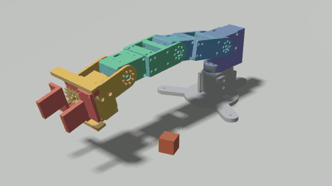
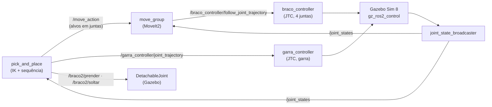
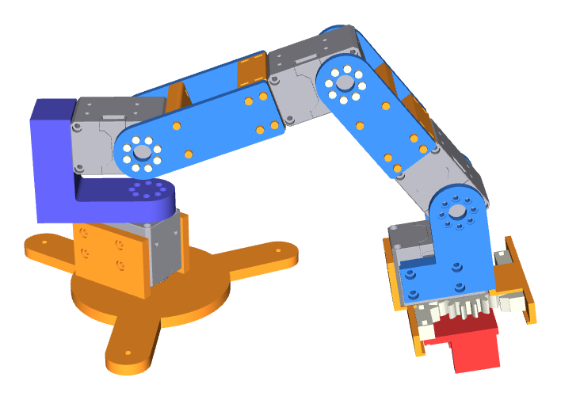
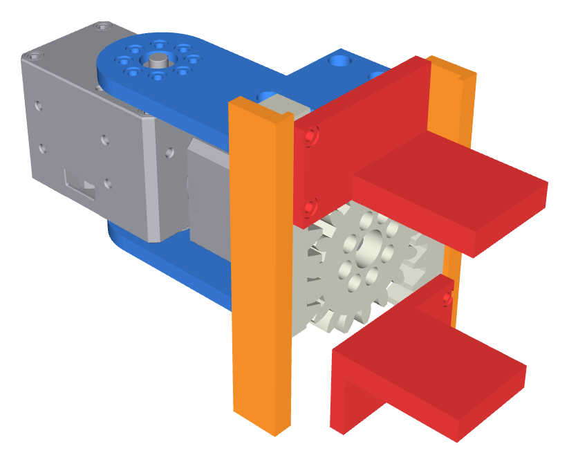

# Braço robótico de 4 juntas com MoveIt2

> Braço robótico serial de 4 juntas com garra paralela de pinhão e cremalheira, projetado para impressão 3D em PLA com servos DYNAMIXEL, e simulado de ponta a ponta no ROS 2: CAD → URDF → Gazebo + ros2_control → MoveIt2 → pick and place.

[](https://docs.ros.org/en/jazzy/)
[](https://www.python.org/)
[-E95420?logo=ubuntu&logoColor=white)](https://ubuntu.com/)
[](https://github.com/Danion1/robot-arm-moveit2/actions/workflows/ci.yml)
[](LICENSE)

🇺🇸 [English version](README.md)

---

## Demonstração



Vídeo completo (34 s):

https://github.com/user-attachments/assets/49e8848e-3dfa-48d0-ab95-0e6c0371d6d8

Foi renderizado por uma câmera simulada sincronizada com a física, então roda liso mesmo com a simulação feita no WSL2 sem placa de vídeo (1029 quadros, nenhum perdido).

**Status:** Só simulado. CAD projetado para fabricação, ainda não impresso. Cinemática, URDF, torques no Gazebo, checagem de colisão do MoveIt2 e o pick and place estão validados contra o CAD (números abaixo).

*Desenvolvido num ambiente privado (10 a 14 de outubro de 2026); este repositório é a versão pública limpa. O CI compila os pacotes ROS 2 e roda os testes a cada push.*

---

## Visão geral

O objetivo era um modelo só, que servisse para a simulação e para a fabricação. O braço é projetado de forma paramétrica em Python (CadQuery): os parafusos seguem as tabelas ISO, a furação dos servos vem dos desenhos da ROBOTIS e a espessura das chapas sai de um cálculo de tensão no torque de stall do servo. O mesmo script gera as malhas, massas e inércias do URDF. Cada etapa tem uma conferência automática contra uma referência independente antes de qualquer exportação.

Pontos principais:
- **CAD paramétrico em CadQuery**: um modelo gera as peças imprimíveis (STEP/STL) e as malhas da simulação.
- **Cinemática inversa analítica** (braço planar + giro da base, lei dos cossenos), validada contra os sólidos do CAD e no Gazebo.
- **Gazebo + ros2_control** com comando de posição (o modo padrão dos servos reais); o torque de gravidade simulado bate com a conta pelas massas do CAD em menos de 0,15 %.
- **Colisão do MoveIt2** conferida contra os sólidos do CAD: nenhuma pose que o MoveIt2 libera colide no CAD (600 poses sorteadas).
- **Pick and place** com pega conferida: a garra tem de parar no objeto antes do alvo, senão o nó aborta sem prender.

---

## Arquitetura



| Componente | Papel | Escrito por mim / configurado |
|---|---|---|
| `cad/*.py` (CadQuery) | peças, montagem, massa/inércia, malhas, geradores do URDF e do MoveIt2, todos com conferências | escrito (com ajuda de IA) |
| `braco2_description` | URDF, malhas, mundos do Gazebo, launch | URDF gerado; `controladores.yaml` e `gazebo.launch.py` escritos à mão |
| `braco2_nos/cinematica.py` | cinemática direta e inversa, 15 testes | escrito |
| `braco2_nos/mover_para_ponto.py` | nó: alvo cartesiano → IK → trajetória das juntas | escrito à mão |
| `braco2_nos/pick_and_place.py` | nó: pick and place completo pelo MoveIt2, com conferência da pega | escrito (com ajuda de IA) |
| `braco2_moveit_config` | SRDF, matriz de colisão, limites, controladores | gerado por script e validado |
| MoveIt2, ros2_control, Gazebo | planejamento, controle, física | configurado |

---

## Decisões de engenharia

Lista completa, com as alternativas: [docs/decisions.md](docs/decisions.md) (em inglês).

| Decisão | Alternativa considerada | Por quê |
|---|---|---|
| Braço em série | Paralelogramo | O laço fechado é mal descrito no URDF e complica o MoveIt2; aceitei mais torque no ombro em troca de software mais simples |
| XM430-W350 (base, ombro, cotovelo), XC430-W240 (punho, garra) | XM540 (mais pesado), XW430 (datasheet contraditório) | Escolhidos pelo cálculo de torque com as massas do CAD |
| Comando de posição | Comando de esforço | É o modo padrão dos servos reais, e o XC430 não tem modo de torque: simular o que o hardware não faz não transferiria |
| IK analítica, MoveIt2 com alvos em juntas | Solver KDL do MoveIt2 | Com 4 juntas o KDL só resolve posição (a orientação sai qualquer uma) |
| Colisão = uma caixa por peça, margem de 1 mm | Malha detalhada / fecho convexo | A malha é lenta; o fecho convexo fecha o vão da garra e das forquilhas |
| Pega híbrida: a física fecha, a pega é conferida, depois uma junta fixa segura | Só atrito / sempre prender / teletransporte | Pega só por atrito é instável no Gazebo; prender sempre esconderia uma pega errada |
| Motor de física Bullet-Featherstone no mundo do pick and place | DART (padrão do Gazebo) | O DART não suporta a junta mimic da garra, e só um dedo andava |

---

## Validação

Todos os resultados vêm de scripts que rodam sem janela, num workspace temporário e numa rede ROS isolada.

| O quê | Método | Resultado |
|---|---|---|
| Cinemática direta | Fórmula à mão x cadeia de sólidos do CAD (30 poses) e x cadeia do URDF | erro máximo 1,1e-13 mm |
| Cinemática inversa | 15 testes + IK de poses tiradas dos sólidos do CAD (30 poses) | testes passam; erro máximo 4,4e-13° |
| URDF | Conferências do gerador: massas = CAD, total 740 g, limites, `check_urdf`, caixas de colisão = caixas do CAD | 7 conferências passam |
| Gazebo + ros2_control | 5 alvos cartesianos pelo `mover_para_ponto` | erro da TF 0,000 mm; torque das juntas x gravidade do CAD < 0,15 %; alvo inalcançável recusado |
| Colisão do MoveIt2 | 600 poses sorteadas (com e sem mesa), MoveIt2 x interseção dos sólidos do CAD | concordam em 565; 0 perigosas (MoveIt2 diz livre, CAD colide); 35 conservadoras |
| Trajetórias do MoveIt2 | 10 movimentos planejados e executados, interpolados de 1° em 1° contra o CAD | todos livres de colisão, dentro dos limites e da velocidade, terminando no alvo; desvio encontrado onde a reta nas juntas bateria na mesa |
| Física da pega | Gazebo: mimic, pega no vazio, aproximação, fechamento, subida, soltura | a garra para em 10,7-11,0 mm por dedo num cubo de 20 mm (contato esperado em 11,0); sobe 40 mm junto com a mão |
| Nó de pick and place | Ida e volta (2 pegas) + pega num ponto vazio | objeto de volta a menos de 5 mm; pega no vazio reprovada sem prender |

Para reproduzir (de dentro de `ros2/`):
```bash
bash conferir_mover.sh              # Gazebo + mover_para_ponto (~2 min)
CADQUERY_PYTHON=/caminho/do/venv/bin/python bash conferir_moveit.sh   # MoveIt2 x CAD (~10 min)
bash conferir_pega.sh               # física da pega (~3 min)
bash conferir_pick_and_place.sh     # nó pick_and_place (~5 min)
bash gravar_demo.sh                 # grava midia/pick_and_place.mp4 (~4 min)
```

---

## Projetado para fabricação

<p align="center">
  
  
</p>

| Peça | Qtd. | Fonte |
|---|---|---|
| DYNAMIXEL XM430-W350-T | 3 | [e-Manual ROBOTIS](https://emanual.robotis.com/docs/en/dxl/x/xm430-w350/) |
| DYNAMIXEL XC430-W240-T | 2 | [e-Manual ROBOTIS](https://emanual.robotis.com/docs/en/dxl/x/xc430-w240/) |
| Parafusos allen ISO 4762 + porcas sextavadas ISO 4032 (embutidas no plástico) | por montagem | tabelas ISO em `cad/lib/parafusos_iso.py` |
| Peças impressas (tripé da base, torre, chapas dos elos, garra com pinhão m2 z18 e cremalheiras) | 19 | [Imprimir e montar](#imprimir-e-montar) |

Peças imprimíveis: STL e STEP de cada peça estão em `cad_export/`, gerados pelos scripts de `cad/`; PLA (densidade e resistência da ficha do PLA da SD3D). Todo datasheet e norma usados têm link em [docs/sources.md](docs/sources.md) (em inglês). Folgas que dependem da impressora estão marcadas como ASSUMIDAS num parâmetro único, para trocar depois de uma impressão de teste. **Ainda não construído.**

Números principais: elos de 105 / 90 / 83,5 mm; alcance 278,5 mm; massa total 740 g; carga útil de 56 g com o braço esticado (limitada pelo ombro); a base tem de ser presa na mesa (solta, o braço tomba).

### Imprimir e montar

Não existe impressão em peça única: cada peça abaixo é impressa sozinha, e as peças se aparafusam em volta dos servos. Clique num STL para vê-lo em 3D no GitHub (o botão de download fica nessa página), ou baixe tudo de uma vez em **Code → Download ZIP**. As quantidades vêm da lista de materiais que os próprios scripts do CAD imprimem.

| Peça impressa | Qtd. | Arquivo | Onde vai |
|---|---|---|---|
| Base (placa em tripé + berço do servo) | 1 | [base.stl](cad_export/base/base.stl) | na mesa, segura o servo da base |
| Torre (imprimir DE LADO) | 1 | [torre.stl](cad_export/base/torre.stl) | horn do servo da base → servo do ombro |
| Chapa do braço | 2 | [braco/chapa.stl](cad_export/braco/chapa.stl) | ombro → cotovelo (uma do lado do horn, outra do lado do idler) |
| Flange do braço | 1 | [braco/flange.stl](cad_export/braco/flange.stl) | espaçador no servo do cotovelo |
| Chapa do antebraço | 2 | [antebraco/chapa.stl](cad_export/antebraco/chapa.stl) | cotovelo → punho |
| Flange do antebraço | 1 | [antebraco/flange.stl](cad_export/antebraco/flange.stl) | espaçador no servo do punho |
| Ponte | 2 | [junta/ponte.stl](cad_export/junta/ponte.stl) | espaçador entre as duas chapas de cada elo (uma por elo) |
| Chapa da mão | 2 | [chapa_mao.stl](cad_export/garra/chapa_mao.stl) | punho → servo da garra |
| Pinhão (m2, z18) | 1 | [pinhao.stl](cad_export/garra/pinhao.stl) | horn do servo da garra |
| Cremalheira | 2 | [cremalheira.stl](cad_export/garra/cremalheira.stl) | movida pelo pinhão, uma por dedo |
| Mordente | 2 | [mordente.stl](cad_export/garra/mordente.stl) | aparafusado em cada cremalheira |
| Guia de cima / de baixo | 1 + 1 | [guia_cima.stl](cad_export/garra/guia_cima.stl), [guia_baixo.stl](cad_export/garra/guia_baixo.stl) | trilhos das cremalheiras, no servo da garra |

19 peças impressas em PLA. (`cad_export/junta/chapa.stl` é a forquilha avulsa usada para validar o desenho das chapas; o braço não usa.)

Para comprar, além dos 5 servos: parafusos allen ISO 4762 M2×5 (48), M2×6 (8), M2×8 (28), M2×10 (8), M2,5×6 (14), M2,5×8 (8), M2,5×12 (8), M2,5×16 (4); porcas sextavadas ISO 4032 M2 (28, embutidas no plástico); 3 parafusos M3 ou grampos para prender a base na mesa. Controlador, fonte e cabos ainda não foram projetados.

Ainda não impresso: a orientação de impressão (fora a da torre), os suportes e o preenchimento não foram testados, e as folgas que dependem da impressora são um parâmetro único ASSUMIDO, a ajustar depois de uma impressão de teste.

---

## Tecnologias

- **Robótica:** ROS 2 Jazzy, ros2_control, Gazebo Sim 8 (gz_ros2_control), MoveIt2, RViz2
- **CAD:** CadQuery (Python, OpenCASCADE)
- **Linguagens:** Python 3.12, URDF/Xacro, SRDF, SDF, YAML
- **Ambiente:** Ubuntu 24.04 no WSL2 (WSLg para as janelas)

---

## Como rodar

### Pré-requisitos
- ROS 2 Jazzy (`source /opt/ros/jazzy/setup.bash`)
- `sudo apt install ros-jazzy-moveit ros-jazzy-ros-gz ros-jazzy-gz-ros2-control ros-jazzy-ros2-controllers`
- Para gerar o CAD de novo: um venv Python com CadQuery (`pip install cadquery`)

### Compilar
```bash
git clone https://github.com/Danion1/robot-arm-moveit2.git
mkdir -p ~/ros2_ws/src
ln -s "$PWD"/robot-arm-moveit2/ros2/braco2_* ~/ros2_ws/src/
cd ~/ros2_ws
colcon build --symlink-install
source install/setup.bash
colcon test --packages-select braco2_nos && colcon test-result --verbose   # testes de unidade da cinemática
```

### Rodar
```bash
# Terminal 1: Gazebo + MoveIt2 + RViz2 com o cubo na mesa
ros2 launch braco2_moveit_config pick_and_place.launch.py

# Terminal 2: pega o cubo e o deixa do outro lado (ciclos:=2 traz de volta)
ros2 run braco2_nos pick_and_place --ros-args -p ciclos:=2
```

### Gerar o CAD de novo (opcional)
As malhas, o URDF e a configuração do MoveIt2 já estão no repositório. Para refazê-los a partir do CAD:
1. Baixe o STEP oficial do X430 no site da ROBOTIS para `fontes/fabricante/` (passos e SHA-256 em [docs/sources.md](docs/sources.md); o arquivo não é redistribuído aqui).
2. Rode os scripts de dentro de `cad/`, nesta ordem (cada um confere o resultado antes de exportar):
```bash
cd cad
python junta.py && python elo.py && python base.py && python garra.py   # peças → cad_export/
python montagem.py            # montagem, colisões, cinemática direta x sólidos
python massa.py               # massa e inércia por elo → resultados/massas.json
python malhas_urdf.py         # malhas visual + colisão por elo
python gerar_urdf.py          # URDF + xacro do Gazebo
python gerar_moveit_config.py # SRDF, matriz de colisão, limites, controladores
```
Os STEP de montagem (`*_montagem.step`, `montagem/braco_completo.step`) só são criados na sua máquina, porque embutem o modelo do servo do fabricante.

### Conferir que está funcionando
```bash
ros2 control list_controllers          # joint_state_broadcaster, braco_controller, garra_controller: active
ros2 topic echo --once /braco2/estado_pega   # "attached" durante o transporte
```

---

## Estrutura do repositório

```text
cad/          scripts CadQuery: peças, montagem, massa, malhas, geradores do URDF/MoveIt2, conferências
cad/lib/      módulos de CAD compartilhados usados aqui (conferência de caixa, export STL, massa/inércia, parafusos ISO, dados dos servos, renders)
cad_export/   peças imprimíveis, STL + STEP
fontes/       script que confere o STEP do servo; arquivos do fabricante vão em fontes/fabricante/ (fora do Git)
ros2/         pacotes ROS 2 + scripts de conferência sem janela (conferir_*.sh)
resultados/   dados gerados usados pelas conferências (massas, caixas de colisão, respostas do MoveIt2)
midia/        vídeo e GIF da demonstração
docs/         decisões de engenharia, fontes, imagens (em inglês)
```

`cad/lib/` é uma cópia congelada dos módulos que este projeto usa da minha biblioteca de CAD (tirada do commit `11b1f2f`, 2026-10-17). Os nomes no código e os comentários estão em português; renomeá-los quebraria pacotes e testes já validados.

---

## Limitações

- Só simulado; nada foi construído nem testado em hardware.
- No transporte, quem segura o cubo é uma junta fixa, então o escorregamento na garra não é simulado. A pega em si (fechar no objeto, parar na largura dele) é física.
- A posição do objeto é conhecida de antemão (sem percepção): ela entra no nó como parâmetros ROS, por exemplo `ros2 run braco2_nos pick_and_place --ros-args -p objeto_x:=0.16 -p objeto_y:=0.06 -p destino_x:=0.16 -p destino_y:=-0.06` (metros, no frame da base). O objeto não está na cena de planejamento do MoveIt2, por isso a aproximação e o recuo são na vertical.
- Com a garra apontando para baixo, a área de trabalho é um anel de ~140 a 170 mm do eixo da base.
- Repetibilidade da soltura na simulação: 0,2 a 4,2 mm (3 rodadas).
- As caixas de colisão são conservadoras: o MoveIt2 pode recusar algumas poses possíveis (no pior caso, caixa a 43 mm do sólido real).
- Os limites de ±90° do cotovelo e do punho são a faixa verificada no CAD, não os batentes do hardware. Os limites de aceleração e o atrito do cubo são assumidos (sem valor de datasheet).

---

## Próximos passos

- [x] CAD paramétrico, pronto para fabricar, com ferragens ISO e furação de datasheet
- [x] Massa/inércia pelos sólidos; URDF gerado
- [x] IK analítica, validada contra o CAD
- [x] Gazebo + ros2_control, torques validados
- [x] MoveIt2 validado contra os sólidos do CAD
- [x] Pick and place com conferência da pega; vídeo de demonstração liso
- [ ] Percepção: uma câmera (fixa ou no punho) detecta o objeto (marcador ArUco ou cor), e uma calibração mão-olho (transformação câmera → base) converte a detecção nos mesmos `objeto_x` / `objeto_y` que o nó recebe hoje
- [ ] Pôr o objeto na cena de planejamento do MoveIt2 (objeto de colisão preso à garra)
- [ ] Imprimir e montar; trocar o `GazeboSimSystem` pela interface de hardware dos DYNAMIXEL
- [ ] Insertos de latão a quente; roteamento completo dos cabos

---

## Como usei IA

Projetei o braço e tomei as decisões de engenharia: arquitetura em série, escolha dos servos pelo cálculo de torque, tipo de garra, controle por posição, a pega híbrida e validar o MoveIt2 com hardware falso antes do Gazebo. Escrevi à mão a configuração dos controladores, o launch do Gazebo, partes do URDF e o primeiro nó ROS 2 (`mover_para_ponto`). Nos scripts maiores (os geradores do CAD e o nó de pick and place) usei um assistente de IA (Claude) como par de programação, trabalhando a partir das minhas especificações. Nada foi aceito por confiança: todo resultado é conferido automaticamente contra referências independentes (os sólidos do CAD, contas à mão, datasheets).

---

## Autor

**Daniel Dos Santos Da Silva** · [GitHub](https://github.com/Danion1) · [LinkedIn](https://www.linkedin.com/in/daniel-dos-santos-da-silva-32a2b23ba/) · [danion.neros@gmail.com](mailto:danion.neros@gmail.com)

## Licença

Apache License 2.0 — ver [LICENSE](LICENSE).
